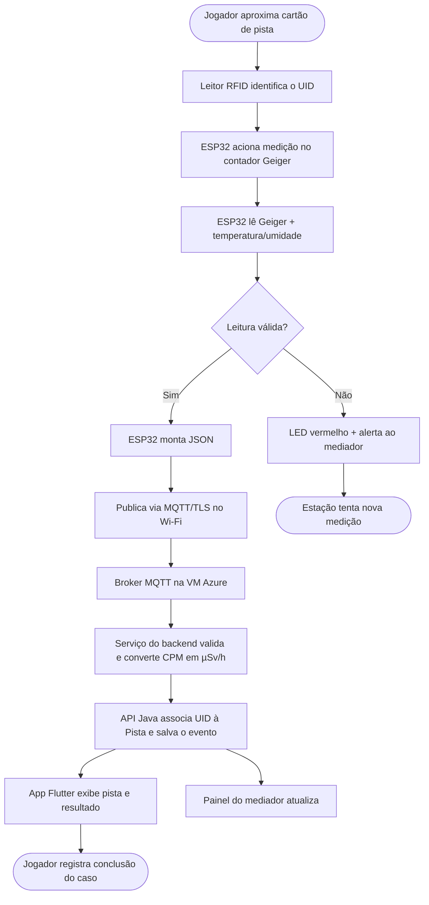

# Nuclear Case — Proposta de IoT e Redes

**Integrantes:** Gabriel Deotti Zanatta
RM: 567258
Murilo Massini
RM: 567383
Giovanni Sacristan
RM: 567248
Caike Roberto de Souza Hollo
RM: 568104

> Disciplina: Disruptive Architectures: IoT, IoB & Generative IA — Sprint 1
> Proposta **conceitual**: não há implementação nesta etapa. Modelos de sensores e protocolos são sugestões a validar com o grupo.


## 1. Descrição da aplicação

O Nuclear Case é um jogo educativo de investigação científica sobre tecnologia nuclear. A proposta de IoT é a **Estação Detetive**: um kit físico, instalado em escolas, feiras de ciência e espaços de divulgação (como exposições da Marinha), que liga o jogo no celular ao mundo real.

O jogador pega um **cartão de pista** físico, aproxima da estação e a pista correspondente é liberada no aplicativo. Em alguns casos, a estação também faz uma **medição real de radiação natural de fundo** em objetos seguros do dia a dia, como banana, granito ou sal light (cloreto de potássio). A ideia conversa com o slogan *"Descubra o que você não vê"*: o jogador vê, em números, que a radiação existe naturalmente no ambiente.

**Necessidades atendidas**
- Tornar o aprendizado mais concreto e envolvente, com interação física.
- Desmistificar o tema: radiação natural de fundo existe e é medida de forma segura.
- Apoiar o caso *"O alimento radioativo?"*: um alimento irradiado, medido na estação, apresenta leitura compatível com o fundo, ou seja, irradiar não é o mesmo que contaminar. Usa-se apenas amostras seguras; **nenhuma fonte radioativa é manuseada**.
- Dar ao mediador (professor ou monitor) um painel para acompanhar a atividade.

**Contribuição ao projeto:** liga a camada física (estação) ao backend (API Java em Docker na VM Azure) e ao app Flutter, usando o mesmo conceito de Caso e Pista.

## 2. Componentes

| Componente | Função | Onde instalar |
|---|---|---|
| **ESP32** (microcontrolador com Wi-Fi e Bluetooth) | Cérebro da estação: lê sensores, aplica regras locais e publica os dados | Dentro da caixa da estação |
| **Leitor RFID/NFC (ex.: RC522)** | Lê o cartão de pista e identifica qual pista foi apresentada | Face superior da estação |
| **Cartões/tags RFID** | Cada cartão representa uma Pista (UID ligado ao id da Pista) | Com o jogador |
| **Módulo contador Geiger (ex.: tubo SBM-20)** | Mede contagens por minuto (CPM) de radiação natural de fundo; convertida em µSv/h | Câmara de medição com amostras seguras |
| **Sensor de temperatura e umidade (ex.: DHT22)** | Contexto ambiental da medição | Interior da estação |
| **Display OLED** | Mostra a leitura e mensagens ao jogador | Frente da estação |
| **LEDs e buzzer** | Feedback: verde (pista liberada), amarelo (medindo), vermelho (erro) | Frente da estação |
| **Roteador/Access Point Wi-Fi** | Conecta a estação à rede do local e à internet | Sala/ambiente do evento |
| **Broker MQTT (Mosquitto)** | Recebe e distribui as mensagens das estações | VM Azure (Docker) |
| **API REST Java/Spring** | Processa, armazena e expõe os dados | VM Azure (Docker) |
| **App Flutter** | Mostra pista liberada e resultado da medição ao jogador | Celular do jogador |
| **Painel do mediador** (opcional) | Visualiza leituras e estações ativas | Navegador |

## 3. Comunicação e redes

**Topologia:** estrela. Cada estação (ESP32) se conecta via **Wi-Fi 2.4 GHz (IEEE 802.11 b/g/n)** ao roteador do local, que dá acesso à internet. O endereço IP é obtido por DHCP.

**Protocolo de aplicação: MQTT** (modelo publicar/assinar), escolhido por ser leve, simples para microcontroladores e adequado a redes instáveis.

| Camada | Tecnologia |
|---|---|
| Enlace/Física | Wi-Fi 802.11 (2.4 GHz) |
| Rede | IP (IPv4) com DHCP |
| Transporte | TCP |
| Segurança | TLS (porta 8883) + usuário/senha por estação |
| Aplicação | MQTT (estação → broker); HTTP/REST (app e painel → API) |

**Tópicos sugeridos**
- `nuclearcase/estacao/{id}/pista` → UID do cartão lido
- `nuclearcase/estacao/{id}/radiacao` → leitura do contador Geiger
- `nuclearcase/estacao/{id}/status` → estação online/offline

**Exemplo de mensagem**
```json
{
  "estacaoId": "EST-01",
  "pistaUid": "04:A3:1F:2B",
  "cpm": 22,
  "usvh": 0.14,
  "temperatura": 24.5,
  "umidade": 58,
  "timestamp": "2026-10-28T18:00:00-03:00"
}
```

**Alternativa de contingência:** se o Wi-Fi do local falhar, a estação pode usar **Bluetooth Low Energy (BLE)** para enviar a leitura direto ao app do jogador, que a repassa à API quando houver internet.

## 4. O que acontece com os dados

1. **Coleta:** o ESP32 lê o RFID (qual pista) e o Geiger (CPM). O DHT22 traz o contexto ambiental.
2. **Pré-processamento no dispositivo:** média de leituras em janela de tempo, descarte de valores impossíveis e montagem do JSON.
3. **Transmissão:** publicação via MQTT/TLS ao broker na VM Azure.
4. **Processamento no backend:** um serviço assinante do broker (por exemplo, Spring Integration) valida a mensagem, converte CPM em µSv/h com o fator do tubo, compara com a faixa esperada de fundo e associa o UID à **Pista** correspondente.
5. **Armazenamento:** a API Java guarda o evento. *Sugestão em aberto:* uma entidade `Leitura` só deve ser criada se o grupo e o responsável por Banco de Dados concordarem; o contrato base (Caso, Pista, Pergunta, Alternativa) permanece como está.
6. **Consumo:** o app Flutter consulta a API e exibe a pista e o resultado; o painel do mediador mostra estações ativas e leituras recentes.

**Quem usa os dados:** jogador (app), mediador (painel) e o próprio sistema (liberar pista, alertar falha).

## 5. Resposta e benefício gerados

- **Liberar a pista** correspondente no app ao aproximar o cartão.
- **Exibir a leitura** com explicação educativa (radiação natural de fundo e seus valores típicos).
- **Alertar o mediador** se a estação ficar offline ou enviar leitura fora de faixa (possível falha do sensor).
- **Feedback imediato** na estação (LED, display e buzzer).
- **Apoiar decisão:** o mediador vê quais casos geram mais interesse e dúvida.

## 6. Fluxograma



> Sprint 1: proposta conceitual. Nenhuma integração real entre estação, API e app foi implementada.
